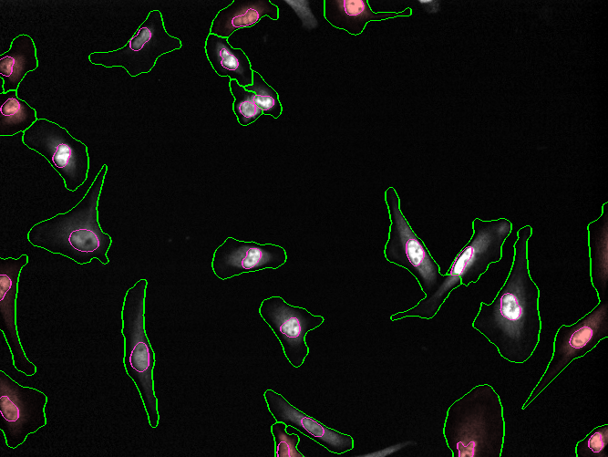
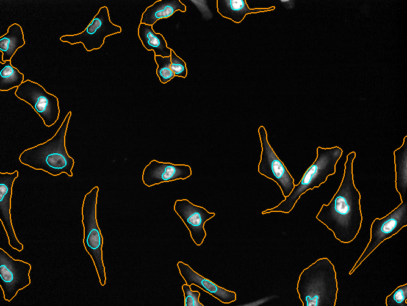

::: {.callout-note}
## At a glance
- **Biological question:** What fraction of YAP/TAZ is nuclear versus cytoplasmic?
- **Data:** TNBC LM2 cells (Pascual-Vargas et al., 2017). TODO: link, DOI, licence
- **Tools:** Python, Cellpose 3
- **Difficulty:** Beginner
:::

## The question

How much of the protein YAP/TAZ sits in the nucleus relative to the cytoplasm? YAP/TAZ localisation is a common readout of mechanical and Hippo pathway signalling: when the pathway is inactive, YAP/TAZ is largely excluded from the nucleus, and when it is active, more of it moves in. Measuring the nuclear-to-cytoplasmic ratio is a way to quantify that state [@pascualvargas2017].

## The tempting approach

The obvious thing is to drop the image into a chat and ask. Here is the prompt used:

> Can you tell me how much of the protein in channel 4 in the attached image is in the nuclei relative to the cytoplasm?

The first time this was asked (in a fresh chat), Claude Opus 5.5 produced this result:



| Measure | Cells fully in frame (n = 13) | All cells (n = 23) |
|---|---|---|
| Share of total signal in the nucleus | ~50% (per cell, median 52%, middle half 46–55%) | 49% |
| Nucleus-to-cytoplasm total signal | ~1.0 : 1 | 0.96 : 1 |
| Nucleus-to-cytoplasm concentration | ~7.4× (middle half 5–10×) | 7.2× |
| Nucleus as share of cell area | 13% | 13% |

Starting a fresh chat and asking the *same* prompt gave a different answer, formatted differently:



| Channel 4, whole image | Value |
|---|---|
| Signal in nuclei | 47.90% |
| Signal in cytoplasm | 52.10% |
| Brightness ratio, nucleus to cytoplasm (mean pixel intensity) | 6.4× |

Both look plausible, but they are not the same, and you cannot tell which is right or why.

::: {.callout-note}
## What actually changed between runs
The two runs chose **different metrics**. Run 1 reported per-cell medians *and* a whole-image total, and separately distinguished the cells fully in frame from all cells. Run 2 reported only a whole-image total and a mean-intensity ratio. Run 1 also split cells into "fully in frame" and "all cells", while run 2 did not.

The segmentations also differ visibly, for example in the clustered cells toward the top of the image. The vague prompt left the methodological decisions to the model, and those decisions changed silently between runs.
:::

## Why that's a problem

- **It is not reproducible.** The same model gave different outputs for the same inputs.
- **It is a black box.** We cannot see how the results were produced. The model probably wrote and ran a temporary script in the background, but we never saw it, so we cannot inspect or rerun it, and neither can anyone else.
- **There is no guarantee of future access.** Even if the result were reproducible today, there is no way to guarantee access to this model in future.
- **Data protection.** Sending your images to an assistant means they are uploaded to a server somewhere, and you have no control over what happens to them.

## A better approach: ask for a script

Instead of asking the assistant to do the analysis, ask it to write a script. This lets you (or anyone else) run the analysis yourself, and it removes the need to upload images at all: you describe them instead.

### The prompt

> I have a microscopy image of some cells in TIF format that I need to analyse. The image consists of 4 channels:
> 1. Nuclei (Hoechst)
> 2. Tubulin
> 3. Actin (Phalloidin)
> 4. YAP/TAZ
> I would like to know what the concentration of YAP/TAZ is in the nuclei relative to the cytoplasm. Can you write a python script to determine this?
> The script should use Cellpose 3 to segment the cells. The outputs should consist of an overlay of the segmented cells on the original image, saved as a PNG file, and a CSV file containing the following columns:
> - Input filename
> - Mean Intensity of YAP/TAZ in Nuclei
> - Mean Intensity of YAP/TAZ in Cytoplasm
> - Nuclear:Cytoplasmic ratio of YAP/TAZ intensity
> Keep the script as short and as simple as possible and make extensive use of comments to aid in interpretation. Include at the beginning of the script detailed step by step instructions on how to run it.

Each part of this prompt does a specific job:

- **Describing the channels** replaces uploading the image, which avoids the data-protection issue.
- **Naming Cellpose 3** is a methodological decision made by you, not the model.
- **Specifying the output columns** fixes the metric, so the result cannot drift between runs.
- **Asking for comments and run instructions** makes the script interpretable to someone who did not write it.

### The script

The script produced from this prompt is shown below, from the [source gist](https://gist.github.com/djpbarry/0ceaeb94a30aa955bdf23922311623cf). You can also [download it](nuc_cyto_ratio.py).

```{.python include="nuc_cyto_ratio.py"}
```

### What the script does, in plain English

Read from the code itself, here is what the script actually does:

1. **Loads the image** and checks that it is a 2D image with exactly four channels, in the order DAPI, tubulin, actin, YAP/TAZ.
2. **Segments whole cells** with the Cellpose 3 `cyto3` model, using the actin channel for the cell body and the DAPI channel for the nucleus.
3. **Segments nuclei** with the same `cyto3` model, using the DAPI channel alone. (Both runs reuse the one model; the script notes this is because `cyto3` is the single Cellpose 3 model that has a backup copy on Hugging Face, since the cellpose.org model server can fail.)
4. **Defines the compartments:** the nucleus is the nuclear pixels inside a cell, and the cytoplasm is the cell pixels outside the nucleus.
5. **Measures YAP/TAZ** as the mean intensity pooled over all cells in the image, and reports the nuclear-to-cytoplasmic ratio.
6. **Saves an overlay** for each image and one CSV summary for all images.

A few choices are worth noting:

- **Cell and nucleus diameters are set by hand** in the script's settings (`CELL_DIAMETER = 50`, `NUC_DIAMETER = 30` pixels), because Cellpose cannot estimate them automatically here.
- **Edge cells are kept** by default (`REMOVE_EDGE_CELLS = False`), so cells touching the image border are included in the pooled measurement.
- **Background subtraction is off** by default (`SUBTRACT_BACKGROUND = False`). The script *can* subtract the median signal outside cells, and its comments explain why that matters, but as shipped it does not.
- The ratio is calculated from **pooled pixels across the whole image**, not per cell then averaged.

## Running it yourself

See [Getting started](../../getting-started.qmd) for step-by-step setup. In short:

1. Create and activate an environment from this example's [`environment.yml`](environment.yml).
2. Run the script on the sample image (`003003-10.tif`): `python nuc_cyto_ratio.py 003003-10.tif`.
3. The first run downloads the Cellpose `cyto3` model (~27 MB), so an internet connection is needed once.

Expected runtime depends on whether a GPU is used. TODO: user to perform (measure CPU vs GPU runtime).

## Results

The overlay and the resulting CSV:


| Input filename | Mean Intensity of YAP/TAZ in Nuclei | Mean Intensity of YAP/TAZ in Cytoplasm | Nuclear:Cytoplasmic ratio of YAP/TAZ intensity |
|---|---|---|---|
| 003003-10.tif | 150.9266 | 28.31363 | 5.330529 |

## Checking the results

"Reproducible" does not mean "correct". Check the result in stages.

### Step 1: inspect the overlay

Look at the overlay image and ask: are the cells outlined correctly? Are any cells merged together or missed? Are the nuclei outlined accurately? Point out any issues you can see in the actual overlay. (The overlay image above is a placeholder pending the script's output; TODO: user to perform.)

### Step 2: spot-check in Fiji

Measure the mean YAP/TAZ intensity by hand in a few regions, then compare.

1. Open the image in Fiji/ImageJ.
2. Draw a region inside a nucleus and use Analyze > Measure to get its mean intensity.
3. Draw a region in the cytoplasm of the same cell and measure again.
4. Repeat for three to five cells, and record the ratio of the two means for each.

TODO: user to perform (present the hand measurements and the comparison table; do not invent values).

### Step 3: why do the three approaches disagree?

The two chat runs gave a concentration ratio of roughly 6.4–7.4×, while the script gave 5.3×. The disagreement is not automatically an error; it shows why the method must be explicit. Plausible contributors include differences in segmentation, the choice of metric (total signal versus mean intensity), whether background is subtracted, and whether the ratio is per cell or pooled across the whole image. The script analysis above shows which of these actually differ: the script pools pixels, keeps edge cells, and does not subtract background by default.

A short note on **background subtraction**: an offset added to both compartments pushes their ratio toward 1, so whether you subtract background changes the ratio even when nothing biological changed. That is why it matters conceptually, and why the script exposes it as a setting.

## What domain knowledge helped here

Writing the good prompt needed to know:

- the order of the channels in the file
- that Cellpose exists and suits this task
- the difference between total signal and concentration (mean intensity)
- that edge cells and background matter

This ties back to the article's closing point: specific prompts come from understanding the fundamentals well enough to know what to ask for.

## Limitations and variations

- This is a **single image**, so it is a demonstration, not a statistical analysis.
- The script can be pointed at a folder of images; [Example 2](../../examples/02-counting-nuclei-batch/index.qmd) covers batch processing.
- It reports one image-level number. To report per-cell values instead, the script would need to aggregate its measurements per cell.

## Provenance

- **Model:** Claude Opus 5.5
- **Date:** TODO (ask the user)
- **Prompt:** the verbatim prompt shown above, or see [PROVENANCE.md](PROVENANCE.md).

## Further reading

- Cellpose documentation: TODO: verify link
- The Janelia book's segmentation chapter: TODO: verify link
- Bankhead's chapters on measurements and on background: TODO: verify link
